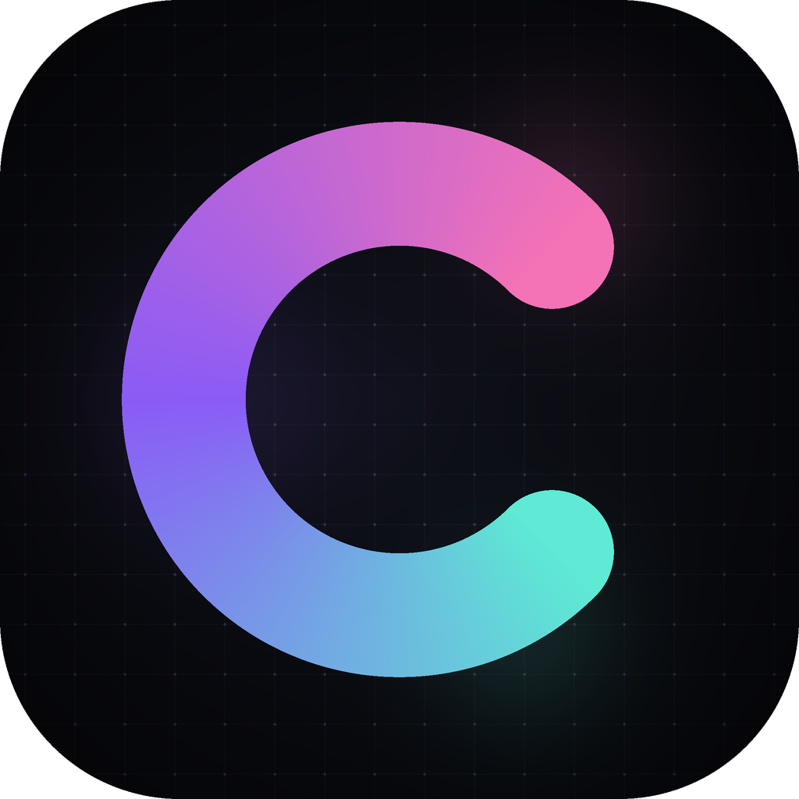
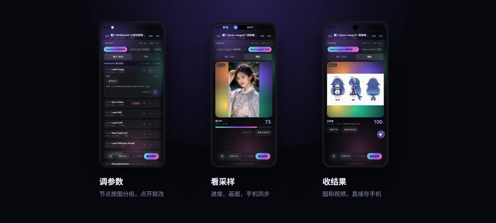
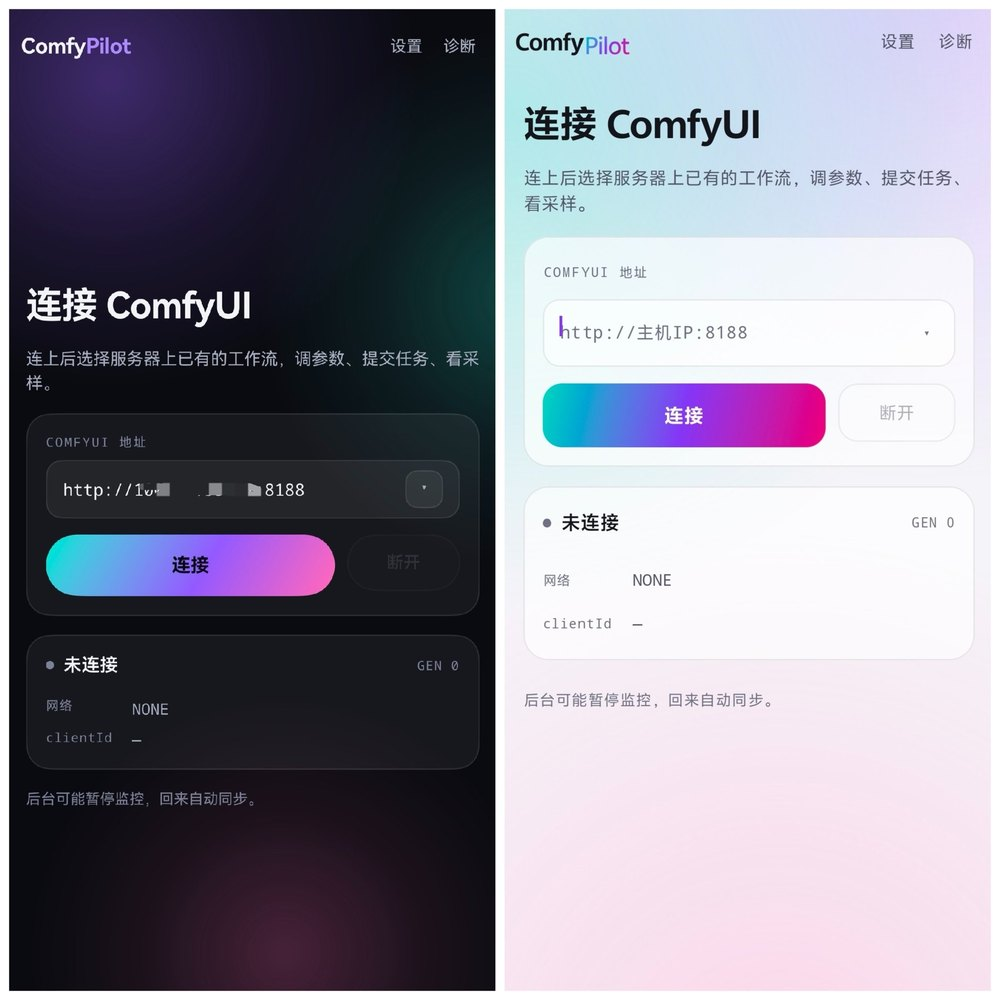
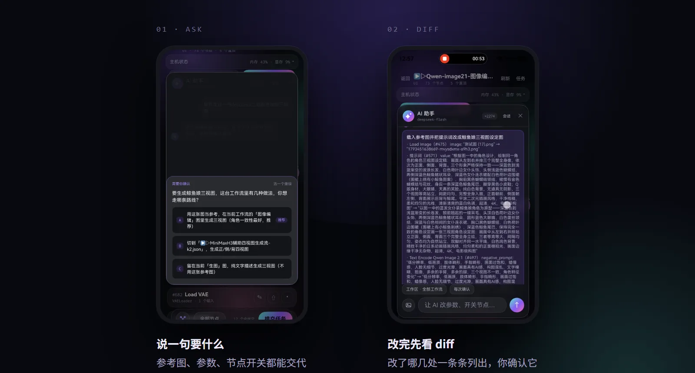
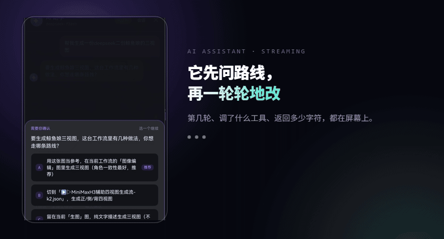
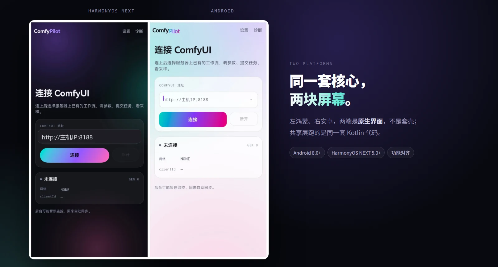
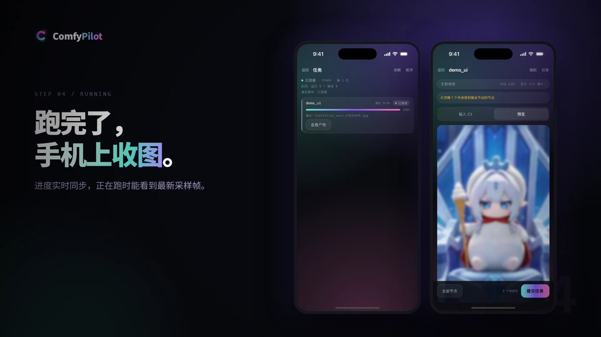
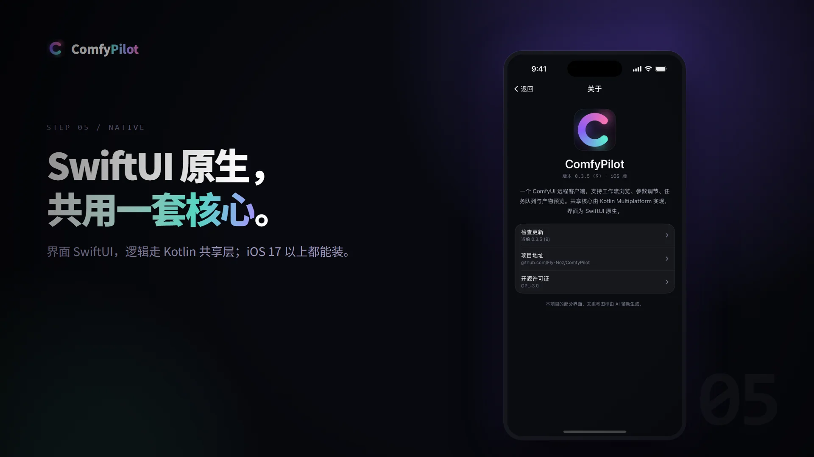
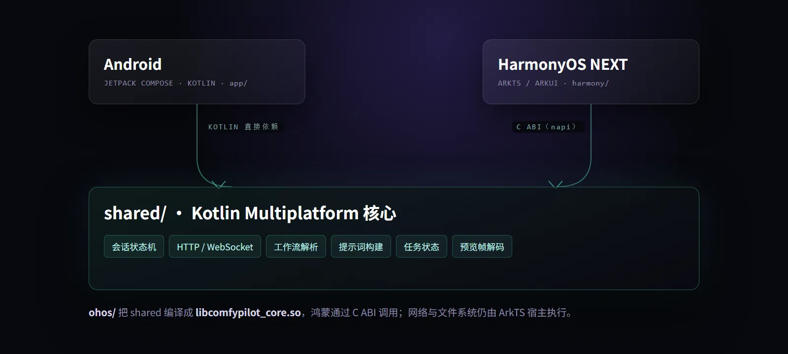
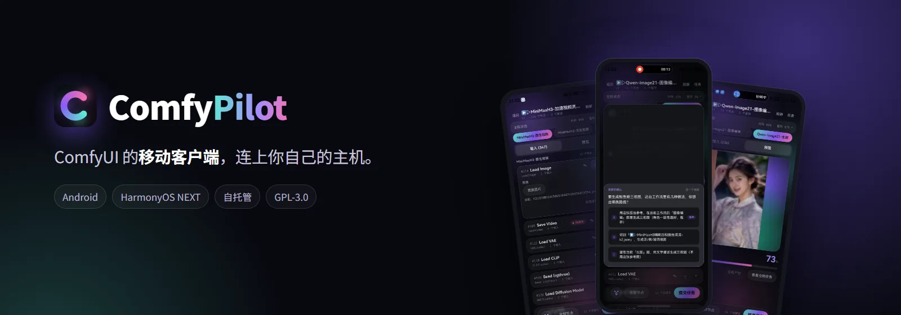

<p align="right"><b>English</b> · <a href="README.md">简体中文</a></p>

<div align="center">



<h1>ComfyPilot</h1>

<p><b>A mobile client for ComfyUI: Android + HarmonyOS NEXT + iOS, sharing one Kotlin core.</b></p>

<p>Connect to your own ComfyUI and watch progress, tune parameters and collect results from your phone.</p>

<p>
  <a href="https://github.com/Fly-Noz/ComfyPilot/releases"></a>
  <a href="https://github.com/Fly-Noz/ComfyPilot/releases"></a>
  <a href="LICENSE"></a>
  
  
  
  <a href="https://afdian.com/a/Fly-Noz"></a>
  <a href="https://github.com/Fly-Noz/ComfyPilot/stargazers"></a>
</p>

</div>

---

> **Unofficial project**: not affiliated with ComfyUI, and not related to the unrelated GitHub project that shares the ComfyPilot name (an MCP server).
> This app only talks to a user-hosted ComfyUI over its public HTTP / WebSocket API. It contains no ComfyUI code and offers no hosted generation service.

> **Interface language**: the app UI is currently Simplified Chinese only. An English UI is not available yet; this document exists so English speakers can evaluate and build the project.

> All images in the demo screenshots are AI-generated and do not depict real people.

## Features

<p align="center"></p>

### Workflows and parameters

- Lists workflows stored on the server; nodes are grouped by graph, and parameters, bypass switches and graph selection are all editable from the phone
- Edits are stored on-device per host + workflow, restored on next launch, and never written back to the server
- Disabling a critical node triggers a dry-run build and a confirmation prompt, so a workflow is not silently broken
- Seed fields support random / reuse last / randomize each run; the mode is stored locally only (Android / HarmonyOS)
- Android / HarmonyOS can import ComfyUI UI workflows from local storage; they stay on-device, are marked as local, and can be deleted without touching the host
- Fields supplied by a link show their source node (e.g. `#330 Seed (rgthree)`)
- Values are coerced to their declared types before submit, so string numbers like `"8"` are not rejected by the server

### Sampling previews

- With [VideoHelperSuite](https://github.com/Kosinkadink/ComfyUI-VideoHelperSuite) installed on the server, sampling shows a looping animation that sharpens as it progresses; without it, previews fall back to single frames
- After a reconnect the last frame is kept and labelled with its age — it never pretends to be live

### Tasks and notifications

- Live progress, task cancellation and queue counts
- Progress and completion notifications while backgrounded or locked, dismissed automatically when you return
- Automatic reconnect and background keep-alive; if a task reports no progress for 60 seconds, the app suggests the host may be loading a model

### Outputs

- Image, video and GIF previews; save to the gallery or the Downloads folder
- Pinch to zoom and drag to pan; double-tap toggles between 1x and 2x

### Themes

- Dark / light / follow system, with one visual spec across all three clients

<p align="center"></p>

### AI assistant (optional)

- A floating button appears after connecting; bring your own OpenAI-compatible endpoint and key
- Change parameters, bypass nodes, pick images, switch workflows, validate and submit in natural language
- Attach images: multimodal models can view them directly; an image is uploaded to ComfyUI only when it has to become a node input
- Reads real server state — GPU/VRAM and available model lists — instead of guessing filenames from memory
- Shows a diff for confirmation by default; auto-submit can be enabled in settings
- Keeps recent turns, compresses them into key points when over budget; undo up to 10 steps
- Remembers recent edits per workflow, so context survives switching away and back
- Keys stay on-device (Android Keystore / HarmonyOS Asset Store) and never pass through any relay

<p align="center"></p>

<p align="center"></p>

<p align="center"><sub>Details (in Chinese): <a href="docs/ai-assistant.md">docs/ai-assistant.md</a></sub></p>

### Monitoring

- RAM and VRAM come from the official `/system_stats`
- CPU / GPU / temperature require [ComfyUI-Crystools](https://github.com/crystian/ComfyUI-Crystools); without it those rows stay hidden and are never faked

### Slow-network mode

- Toggle in settings; the app explains exactly what changes before you enable it
- Slower status polling, multi-frame previews off, stronger image compression on upload, download retries with relaxed timeouts
- AI context is forced to local summaries, with no extra model calls

## Supported platforms

<p align="center"></p>

| Platform | Requirement | Package |
|---|---|---|
| Android | 8.0+ (minSdk 26), install the APK directly | `com.fly.comfypilot.app` |
| HarmonyOS NEXT | 5.0.0(12)+, the HAP must be signed before installing | `com.fly.comfypilot` |
| iOS | 17.0+, install the unsigned IPA after signing it yourself | `com.fly.comfypilot` |

Android and HarmonyOS are close to feature parity, but the **package names differ**: the Android compatibility layer on HarmonyOS identifies apps by package name, so they cannot be identical.

iOS is currently a basic client: connection, workflow parameters, tasks, output previews, sampling previews, host status, diagnostics, About page and update reminders are available. Local workflow import, the AI assistant, network speed tests, VRAM release and seed quick actions are not implemented yet.

## iOS client

<p align="center"></p>

<p align="center"></p>

- Native SwiftUI interface; connection and state machine are driven by `ComfyCore.framework` (Kotlin/Native)
- Supports connection, workflow parameters, node graph, task queue, output viewer, sampling previews, host status, diagnostics, About page and update reminders
- Distributed as an **unsigned IPA** that you sign yourself; requires iOS 17.0+
- Missing for now: local workflow import, AI assistant, network speed test, VRAM release and seed quick actions

## Architecture

<p align="center"></p>

Android depends on `shared` directly. On HarmonyOS, `ohos/` compiles the shared layer into a `.so`; ArkTS calls it through a C ABI, while networking and file access stay in the ArkTS host. On iOS, the shared layer is built as `ComfyCore.framework`; SwiftUI talks to it through a Swift host, with networking and UI implemented natively.

## Repository layout

```
shared/     KMP core: state machine, API, workflow/prompt building, preview decoding
app/        Android client (Jetpack Compose)
ios/        iOS client (SwiftUI + ComfyCore.framework)
ohos/       Kotlin/Native project that produces the .so used by HarmonyOS
harmony/    HarmonyOS client (ArkTS + ArkUI)
tools/
  comfyui/  ComfyUI launch scripts (local/remote) and IP discovery
  mock-comfyui/  offline fake server for UI debugging
  comfy-proxy.mjs  local port forwarding (pairs with adb reverse / hdc rport)
docs/       design assets, release and privacy documents, development notes
```

## Getting started

### 1. Server

ComfyUI must accept connections from your LAN:

```bat
python main.py --listen --preview-method auto
```

On the Windows portable build you can use the bundled scripts (place them in the portable root, next to `ComfyUI\` and `python_embeded\`):

- `tools/comfyui/run_remote.bat`: starts with `--listen` and prints local IPv4 addresses plus adapter names
- `tools/comfyui/run_local.bat`: binds `127.0.0.1` only
- `tools/comfyui/list-ip.ps1`: lists adapters for `run_remote.bat`

See [tools/comfyui/README.md](tools/comfyui/README.md) (Chinese).

> `--listen` has no authentication. Use it on trusted networks only; for public access, put it behind a VPN or tunnel and add access control at the edge.

### 2. Client

- **Android**: download `ComfyPilot-*.apk` from Releases (signed with the project key)
- **HarmonyOS**: the HAP in Releases is **unsigned**; sign it with your own release certificate. For debugging, build and install from DevEco Studio
- **iOS**: the IPA in Releases is an **unsigned** test build; sign it yourself before installing. Tapping the IPA directly on the phone does nothing

### 3. Connect

Enter `http://<host-ip>:8188` in the app, using the address printed by the launch script:

- Same Wi-Fi / hotspot: use the `WLAN` / `Ethernet` address
- Across networks: join both the host and the phone to the same Tailscale / ZeroTier network and use the virtual adapter address (`100.x`)
- USB debugging: `node tools/comfy-proxy.mjs 18188 <host> 8188` plus `adb reverse tcp:18188 tcp:18188`, then enter `http://127.0.0.1:18188`

## Building from source

Requires JDK 21, Android SDK and DevEco Studio 5.0; iOS additionally needs macOS + Xcode + XcodeGen. Full commands, signing and test instructions are in [docs/build.md](docs/build.md).

## Data and privacy

- No data collection and no developer-operated server: the app connects straight to the ComfyUI instance you enter
- Stored on-device only: server address, clientId, parameter drafts, task history, diagnostic logs
- Uninstalling removes them; drafts can be reset under Settings → Workflow parameters
- Privacy policy (Simplified Chinese): [docs/release/privacy-policy.zh-CN.md](docs/release/privacy-policy.zh-CN.md)

## Supporting the project

If ComfyPilot is useful to you, you can support development through Afdian (a Chinese platform):

- **Afdian**: https://afdian.com/a/Fly-Noz

Sponsorship pays for test devices, servers and maintenance. It does not affect features, licensing or updates. The project stays GPL-3.0.

## Known limitations

- HTTP only; for access from outside your LAN, bring your own VPN or tunnel
- Sampling animations require VideoHelperSuite on the server; otherwise previews degrade to single frames
- Loading large models or swapping VRAM can stall ComfyUI's event loop, so no progress events arrive for a long time; after 60 seconds the app suggests the host may be loading a model
- The AI assistant needs your own OpenAI-compatible endpoint and key. Once enabled, workflow structure, parameters and prompts are sent to the provider you configure
- If a workflow references a LoRA or model missing on the server, the app submits the original value and lets the server reject it. The rgthree web UI may silently skip it, in which case that LoRA never takes effect either
- The HarmonyOS build has no active WebSocket heartbeat or VPN detection yet
- `PrimitiveNode` used as a value node in links is still unsupported
- Node IDs can change after subgraph expansion, so local state keyed by node ID (such as "last seed") may not match
- HarmonyOS release packages require AGC signing; the HAP published in Releases is unsigned and intended for debugging or self-signing
- iOS builds are unsigned IPAs that you sign yourself; there is no App Store release yet, and local workflow import, the AI assistant, network speed test and VRAM release are not implemented
- Images saved to the gallery on HarmonyOS are converted to 8-bit RGB PNG (a workaround for a colour artifact with RGBA PNGs in the system gallery preview); animated images are saved as stills

<p align="center"></p>

## License and notices

- Code is released under **GPL-3.0**, see [LICENSE](LICENSE); third-party licenses are listed in [THIRD_PARTY_NOTICES.md](THIRD_PARTY_NOTICES.md)
- This is a third-party client and is not affiliated with ComfyUI; ComfyUI and related names belong to their respective authors
- You are responsible for the compliance of the workflows, models and generated content you submit with this tool
