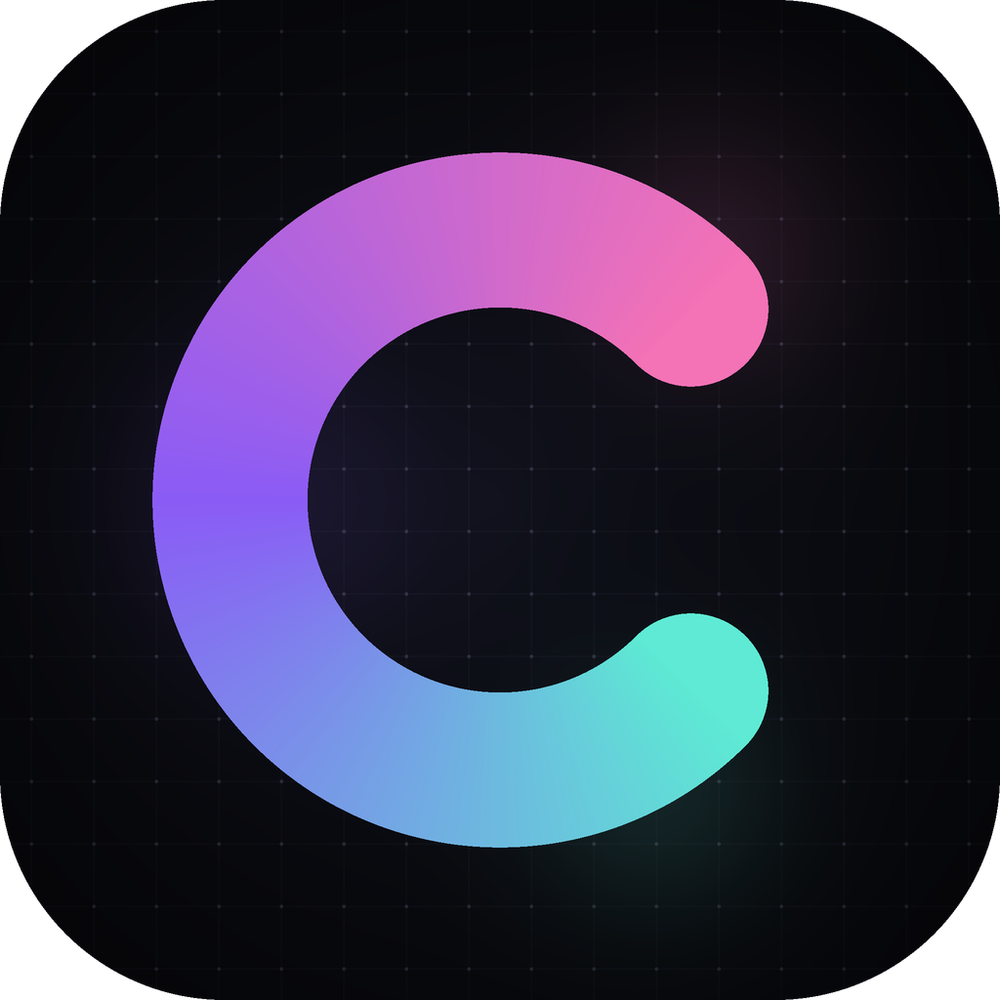
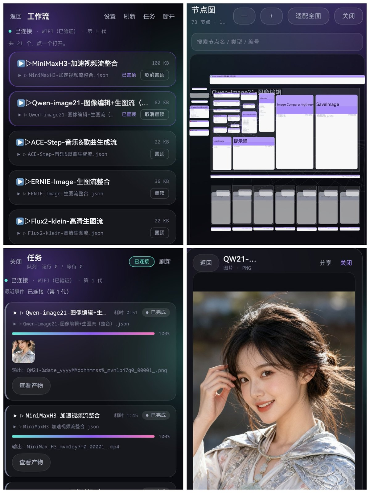
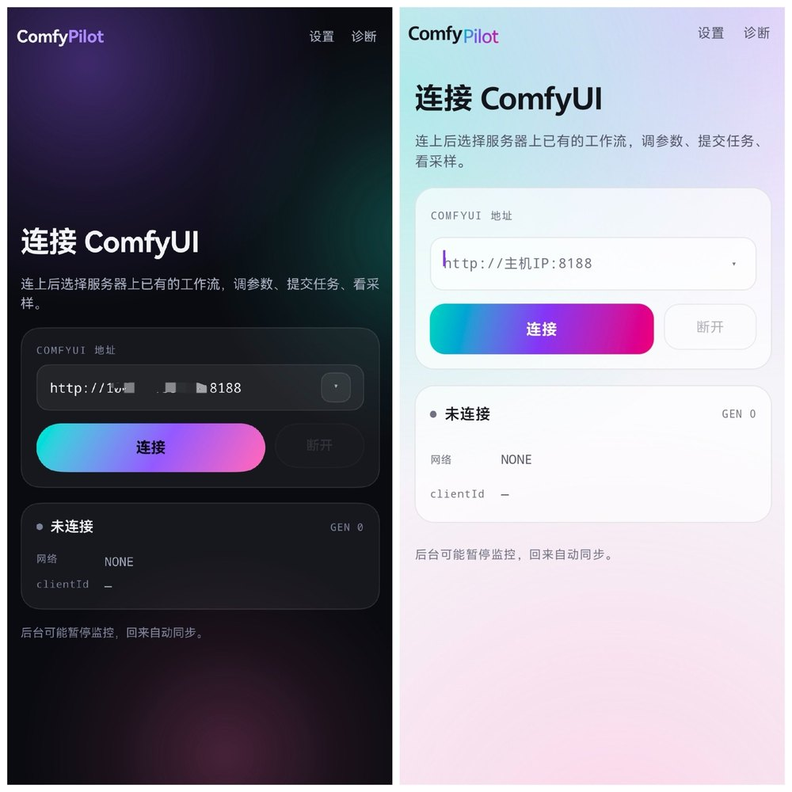
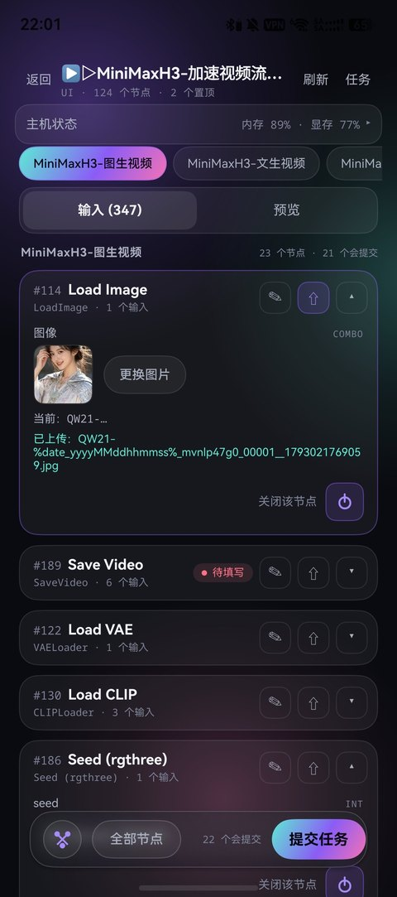

<div align="center">



<h1>ComfyPilot</h1>

<p><b>ComfyUI 的移动客户端：Android + HarmonyOS NEXT，共享一套 Kotlin 核心。</b></p>

<p>连上你自己的 ComfyUI，就能在手机上看进度、调参数、收结果。</p>

<p>
  <a href="https://github.com/Fly-Noz/ComfyPilot/releases"></a>
  <a href="https://github.com/Fly-Noz/ComfyPilot/releases"></a>
  <a href="LICENSE"></a>
  
  
  <a href="https://github.com/Fly-Noz/ComfyPilot/stargazers"></a>
</p>

</div>

---

## 界面

<p align="center">
  
</p>

<p align="center">
  
  
</p>

<p align="center">
  
</p>

<p align="center"><sub>工作流 / 节点图 / 任务 / 产物 · 采样动画 · 深色与浅色 · 节点参数</sub></p>

## 能做什么

- **工作流**：读取服务器上的工作流列表，节点按图分组，参数、开关、节点图选择都能在手机上改
- **参数草稿**：改过的参数按「主机 + 工作流」存在本机，退出重进自动恢复，不写回主机
- **采样预览**：服务端装了 [VideoHelperSuite](https://github.com/Kosinkadink/ComfyUI-VideoHelperSuite) 时，采样过程能看到循环动画，随采样推进逐轮变清晰
- **任务**：实时进度、取消、排队计数；切后台/锁屏可收进度与完成通知
- **产物**：图片/视频/GIF 预览，保存到相册或下载目录
- **连接**：地址历史、自动重连、后台保活；断线重连后保留最后一帧
- **监控**：内存/显存来自官方 `/system_stats`；CPU/GPU/温度需要 [ComfyUI-Crystools](https://github.com/crystian/ComfyUI-Crystools)
- **外观**：深色/浅色/跟随系统，双端同一套视觉规范

## 支持范围

| 平台 | 要求 | 包名 |
|---|---|---|
| Android | 8.0+（minSdk 26），APK 直接安装 | `com.fly.comfypilot.app` |
| HarmonyOS NEXT | 5.0.0(12)+，HAP 需签名后安装 | `com.fly.comfypilot` |

两端功能对齐，但**包名不同**（鸿蒙上的安卓兼容层按包名识别，不能相同）。

## 架构

```
┌──────────────────────┐      ┌──────────────────────────┐
│ Android (Compose)    │      │ HarmonyOS (ArkTS/ArkUI)  │
│  app/                │      │  harmony/                │
└──────────┬───────────┘      └────────────┬─────────────┘
           │ Kotlin 直接调用                 │ C ABI（napi）
           ▼                                 ▼
┌──────────────────────────────────────────────────────────┐
│ shared/  Kotlin Multiplatform 核心                        │
│  会话状态机、WebSocket/HTTP、工作流解析、提示词构建、      │
│  任务状态、预览帧解码、桥协议                              │
└──────────────────────────────────────────────────────────┘
                                             ▲
                              ohos/  Kotlin/Native → libcomfypilot_core.so
```

Android 直接依赖 `shared`；鸿蒙通过 `ohos/` 把共享层编译成 `.so`，ArkTS 用 C ABI 调用，网络与文件系统仍由 ArkTS 宿主执行。

## 仓库结构

```
shared/     KMP 核心：状态机、API、工作流/提示词、预览解码
app/        Android 客户端（Jetpack Compose）
ohos/       Kotlin/Native 工程，产出鸿蒙用的 .so
harmony/    HarmonyOS 客户端（ArkTS + ArkUI）
tools/
  comfyui/  ComfyUI 启动脚本（本地/远程）与 IP 获取
  mock-comfyui/  离线假服务端，UI 调试用
  comfy-proxy.mjs  本机端口转发（配合 adb reverse / hdc rport）
docs/       设计资产、上架与隐私文档、阶段性记录
```

## 快速开始

### 1. 服务端

ComfyUI 需要允许局域网访问：

```bat
python main.py --listen --preview-method auto
```

Windows 便携版可以直接用仓库里的脚本（放到 ComfyUI 便携版根目录，与 `ComfyUI\`、`python_embeded\` 同级）：

- `tools/comfyui/run_remote.bat`：带 `--listen` 启动，并打印本机 IPv4 + 网卡名
- `tools/comfyui/run_local.bat`：只监听 `127.0.0.1`
- `tools/comfyui/list-ip.ps1`：给 `run_remote.bat` 列网卡用

详见 [tools/comfyui/README.md](tools/comfyui/README.md)。

> `--listen` 没有登录认证，只在可信网络使用；公网请走 VPN 或内网穿透，并在外层加访问控制。

### 2. 客户端

- **Android**：从 Releases 下载 `ComfyPilot-*.apk` 安装（项目密钥签名）
- **HarmonyOS**：Releases 里的 HAP 是**未签名**的，需要自己用发布证书签名；调试可直接用 DevEco 构建并安装

### 3. 连接

App 里填 `http://<主机IP>:8188`，主机 IP 用启动脚本打印的那个：


- 同一 WiFi/热点：用 `WLAN` / `以太网` 的地址；
- 跨网络：主机和手机都加入同一个 Tailscale/ZeroTier 网络，填虚拟网卡地址（`100.x`）；
- USB 调试：`node tools/comfy-proxy.mjs 18188 <主机> 8188` + `adb reverse tcp:18188 tcp:18188`，App 里填 `http://127.0.0.1:18188`。

## 构建

### 环境

- JDK 21
- Android SDK（compileSdk 37）
- DevEco Studio 5.0（HarmonyOS SDK 12）与 hvigor

### Android

```bash
./gradlew :app:assembleDebug
# 产物：app/build/outputs/apk/debug/app-debug.apk
```

正式签名构建需要仓库根目录的 `keystore.properties`（参考 `keystore.properties.example`），文件不存在时 release 构建保持未签名。

### HarmonyOS

```powershell
# 编译共享层 .so、复制到头文件目录，再打包 HAP
.\harmony\build.ps1
```

产物：`harmony/entry/build/default/outputs/default/entry-default-unsigned.hap`（配置签名后为 `-signed.hap`）。

首次在 DevEco Studio 打开 `harmony/` 时需要配置签名（自动签名即可）；`harmony/build-profile.json5` 已被 gitignore，模板见 `harmony/build-profile.example.json5`。

### 测试

```bash
./gradlew :shared:jvmTest
```

## 数据与隐私

- 不收集数据、不经过开发者服务器，直连你自己填写的 ComfyUI；
- 本机只保存：服务器地址、clientId、参数草稿、任务记录、诊断日志；
- 卸载即删除；参数草稿可在「设置 → 工作流参数」里恢复默认；
- 隐私政策模板见 [docs/release/privacy-policy.zh-CN.md](docs/release/privacy-policy.zh-CN.md)。

## 已知限制

- 只支持 HTTP 直连，跨公网请自备 VPN/内网穿透；
- 采样动画依赖服务端安装 VideoHelperSuite，未安装时退化为单帧；
- 服务端加载大模型/换出显存时会长时间没有进度事件（ComfyUI 事件循环被占住），App 超过 60 秒会提示「主机可能正在加载模型」；
- HarmonyOS 发布包需要 AGC 签名，仓库里的 HAP 仅供调试/自签名；
- 鸿蒙端保存到相册的图片会转成 8-bit RGB PNG（绕过系统相册对 RGBA PNG 的预览色块问题），动图会保存为静态图。

## 许可证与声明

- 代码以 **GPL-3.0** 发布，见 [LICENSE](LICENSE)；
- 本项目是第三方客户端，与 ComfyUI 官方无关；ComfyUI 及其相关名称归其作者所有；
- 使用本工具提交的工作流、模型与生成内容，由使用者自行负责合规性。
