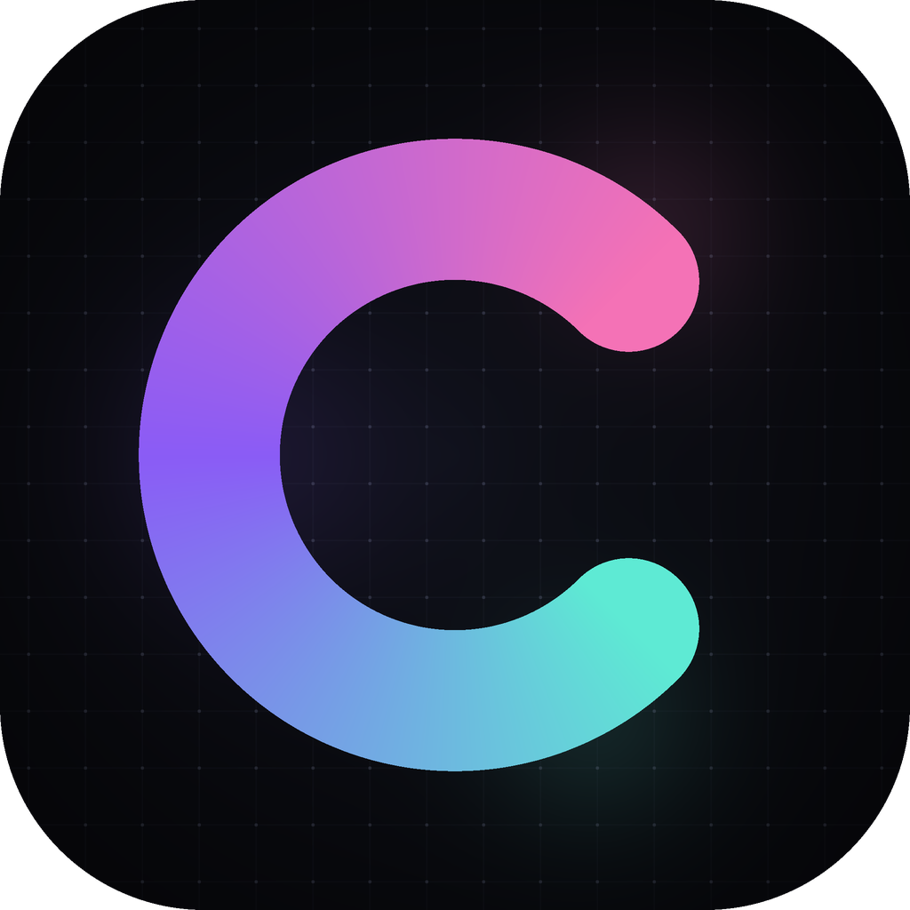
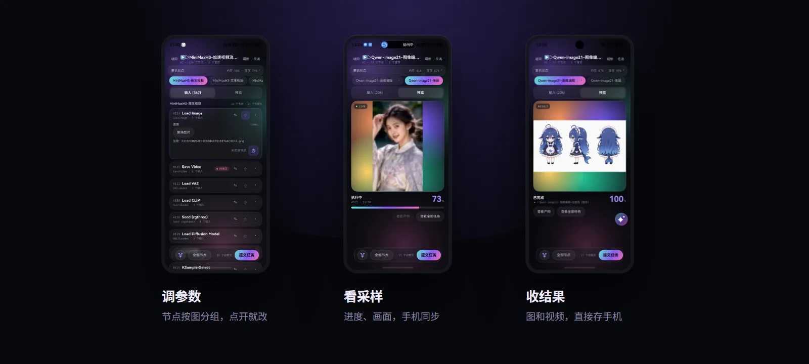
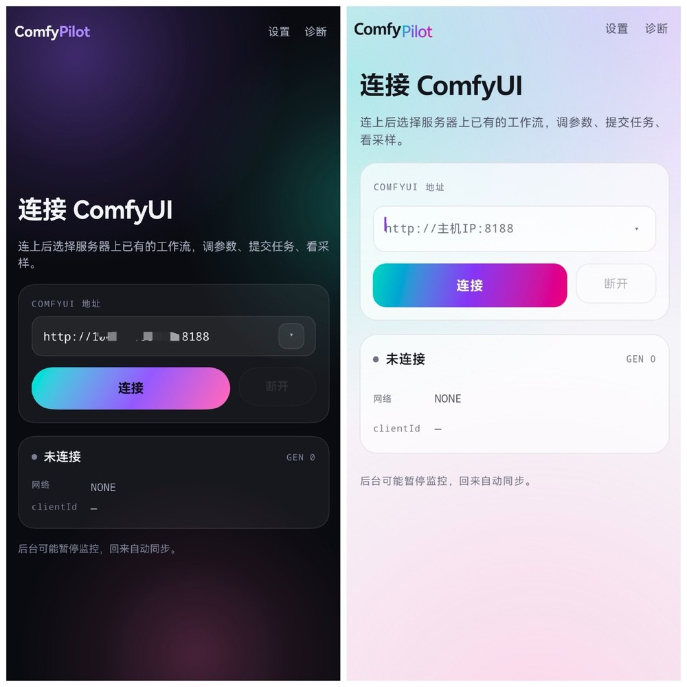
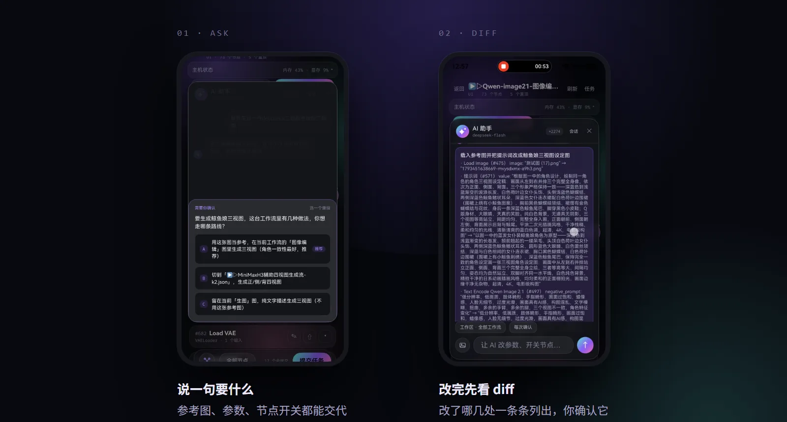
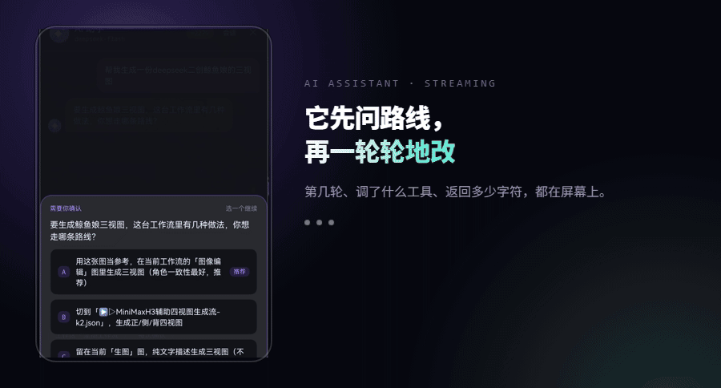
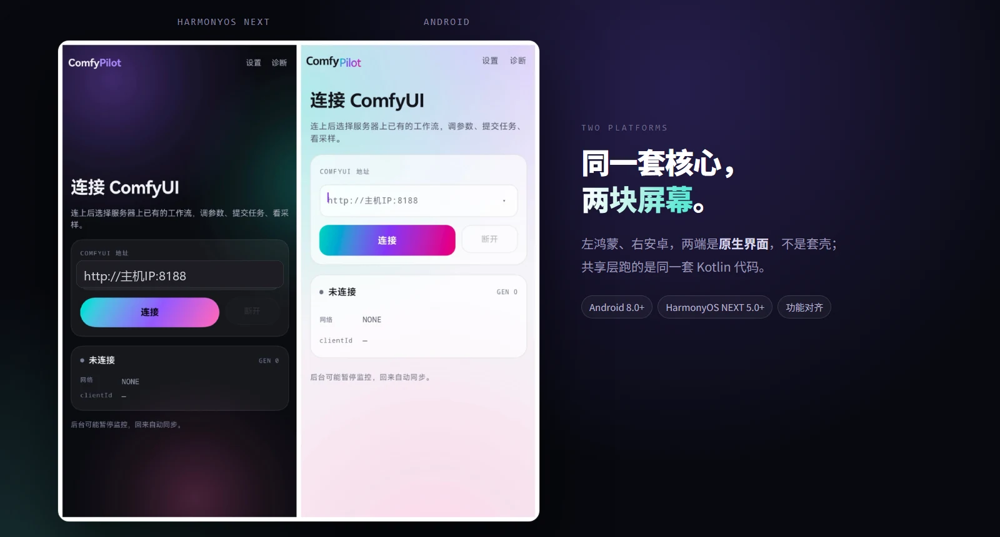
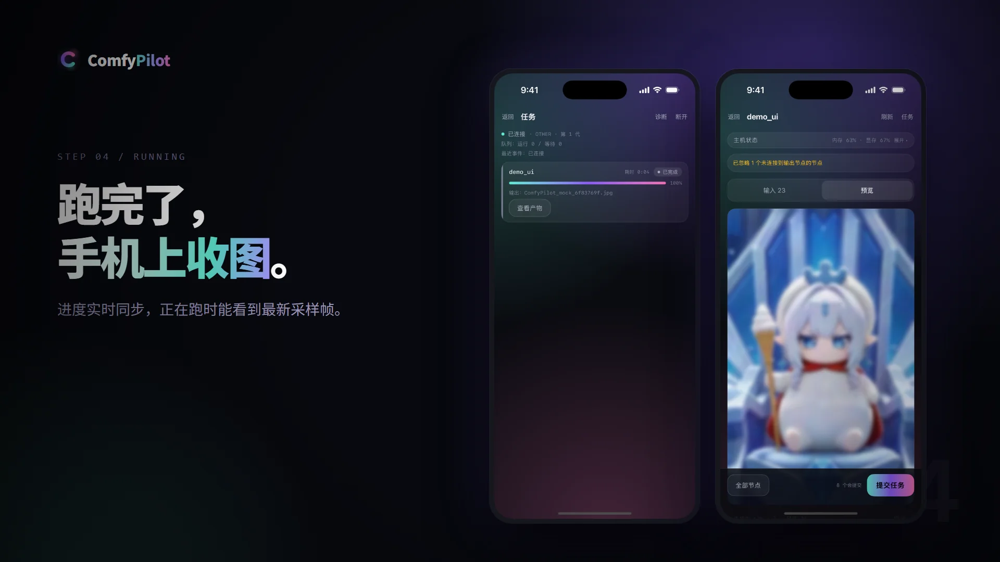
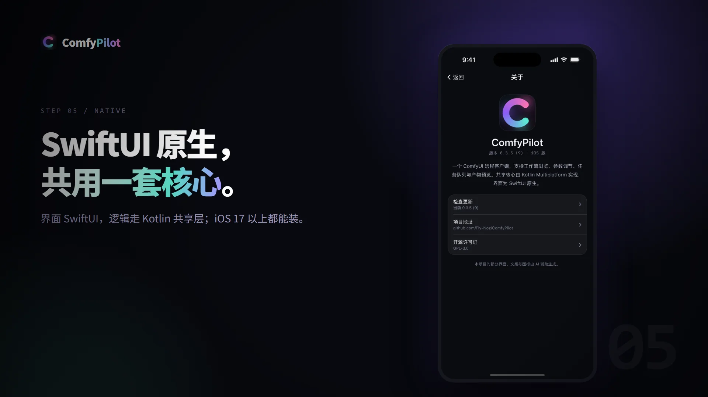
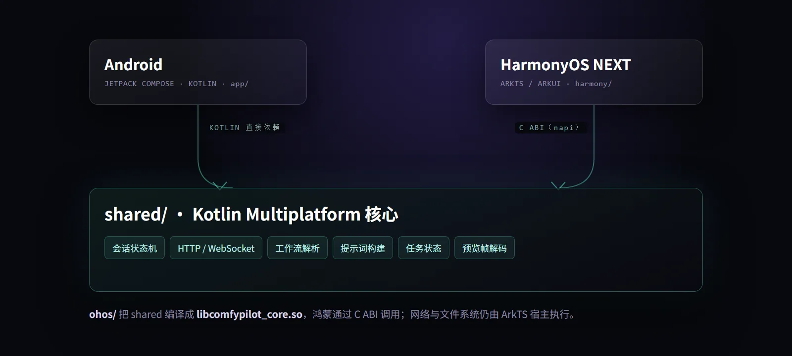
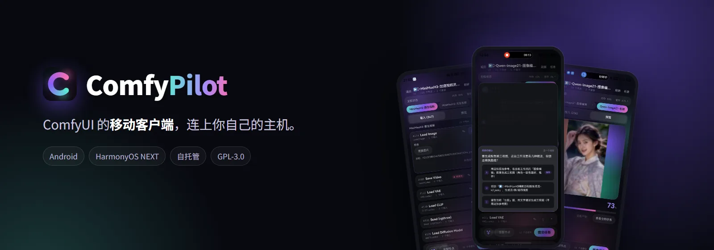

<p align="right"><a href="README.en.md">English</a> · <b>简体中文</b></p>

<div align="center">



<h1>ComfyPilot</h1>

<p><b>ComfyUI 的移动客户端：Android + HarmonyOS NEXT + iOS，共享一套 Kotlin 核心。</b></p>

<p>连上你自己的 ComfyUI，就能在手机上看进度、调参数、收结果。</p>

<p>
  <a href="https://github.com/Fly-Noz/ComfyPilot/releases"></a>
  <a href="https://github.com/Fly-Noz/ComfyPilot/releases"></a>
  <a href="LICENSE"></a>
  
  
  
  <a href="https://afdian.com/a/Fly-Noz"></a>
  <a href="https://github.com/Fly-Noz/ComfyPilot/stargazers"></a>
</p>

</div>

---

> **非官方项目**：与 ComfyUI 官方无关，也与 GitHub 上同名的 ComfyPilot（MCP server）项目无关。
> 本项目只是通过公开的 HTTP / WebSocket 协议连接用户自建的 ComfyUI，不包含 ComfyUI 代码，也不提供任何在线生成服务。

> 演示截图中的图片均由 AI 生成，非真实人物。

## 功能

<p align="center"></p>

### 工作流与参数

- 读取服务器上的工作流列表，节点按图分组，参数、开关、节点图选择都能在手机上改
- 改过的参数按「主机 + 工作流」存在本机，退出重进自动恢复，不写回主机
- 关闭关键节点前会做构建试算并弹确认，避免把工作流改坏
- 种子字段支持「随机 / 使用上次 / 每次随机」，模式只存本机（Android / 鸿蒙）
- Android / 鸿蒙支持从本机导入 ComfyUI UI 工作流，仅存本机、可标记来源与删除，不写入主机
- 连线提供的字段会标出来源节点（如 `#330 Seed (rgthree)`）
- 提交前按字段定义转换类型，避免 `"8"` 这类字符串数字被服务端拒绝

### 采样预览

- 服务端装了 [VideoHelperSuite](https://github.com/Kosinkadink/ComfyUI-VideoHelperSuite) 时，采样过程能看到循环动画，随采样推进逐轮变清晰；未安装时退化为单帧预览
- 断线重连后保留最后一帧，并标注它有多旧，不假装实时

### 任务与通知

- 实时进度、取消任务、排队计数
- 切后台/锁屏可以收到进度与完成通知，回前台自动撤掉
- 自动重连、后台保活；任务超过 60 秒没进度会提示「主机可能正在加载模型」

### 产物

- 图片 / 视频 / GIF 预览，保存到相册或下载目录
- 大图支持双指缩放、拖动，双击在 1x / 2x 间切换

### 主题

- 深色 / 浅色 / 跟随系统，三端同一套视觉规范

<p align="center"></p>

### AI 助手（可选）

- 连接后右下角出现悬浮球，点开对话；用自己的 OpenAI 兼容接口与 Key
- 支持自然语言改参数、开关节点、选图、切换工作流、校验并提交
- 支持附图：多模态模型可直接看图；需要把图用进节点时才上传到 ComfyUI
- 能查服务器真实状态：显卡/显存、可用模型清单，不必凭记忆编文件名
- 默认先展示 diff 再确认，可在设置里改为自动提交
- 上下文保留最近对话，超预算可压缩成要点；撤销最多 10 步
- 会按工作流记住最近几次改动，切换工作流后仍知道当前上下文
- Key 只存本机（Android Keystore / 鸿蒙 Asset Store），不经过任何中转

<p align="center"></p>

<p align="center"></p>

<p align="center"><sub>详见 <a href="docs/ai-assistant.md">docs/ai-assistant.md</a></sub></p>

### 监控

- 内存与显存来自官方 `/system_stats`
- CPU / GPU / 温度需要 [ComfyUI-Crystools](https://github.com/crystian/ComfyUI-Crystools)，未安装时不会显示，也不会伪造数值

### 弱网模式

- 设置里可开关，开启前会说明具体变化
- 状态轮询降频、关闭多帧采样动画、上传图片压缩更狠、下载失败重试并放宽超时
- AI 上下文强制使用本地摘要，不额外调用模型

## 支持范围

<p align="center"></p>

| 平台 | 要求 | 包名 |
|---|---|---|
| Android | 8.0+（minSdk 26），APK 直接安装 | `com.fly.comfypilot.app` |
| HarmonyOS NEXT | 5.0.0(12)+，HAP 需签名后安装 | `com.fly.comfypilot` |
| iOS | 17.0+，未签名 IPA，安装前需自行签名 | `com.fly.comfypilot` |

Android 与鸿蒙功能基本对齐，但**包名不同**（鸿蒙上的安卓兼容层按包名识别，不能相同）。

iOS 目前是基础客户端：连接、工作流参数、任务、产物预览、采样预览、主机状态、诊断、关于页与更新提醒已经可用；本地工作流导入、AI 助手、网络测速、释放显存和种子快捷操作尚未接入。

## iOS 客户端

<p align="center"></p>

<p align="center"></p>

- SwiftUI 原生界面，连接与状态机由 `ComfyCore.framework`（Kotlin/Native）驱动；
- 支持连接、工作流参数、节点图、任务队列、产物查看、采样预览、主机状态、诊断、关于页与更新提醒；
- 发布形式为**未签名 IPA**，需要自行签名安装；最低 iOS 17.0；
- 当前缺口：本地工作流导入、AI 助手、网络测速、释放显存、种子快捷操作。

## 架构

<p align="center"></p>

Android 直接依赖 `shared`；鸿蒙通过 `ohos/` 把共享层编译成 `.so`，ArkTS 用 C ABI 调用，网络与文件系统仍由 ArkTS 宿主执行；iOS 把共享层编译成 `ComfyCore.framework`，SwiftUI 通过 Swift 宿主调用，网络与界面由 iOS 原生层负责。

## 仓库结构

```
shared/     KMP 核心：状态机、API、工作流/提示词、预览解码
app/        Android 客户端（Jetpack Compose）
ios/        iOS 客户端（SwiftUI + ComfyCore.framework）
ohos/       Kotlin/Native 工程，产出鸿蒙用的 .so
harmony/    HarmonyOS 客户端（ArkTS + ArkUI）
tools/
  comfyui/  ComfyUI 启动脚本（本地/远程）与 IP 获取
  mock-comfyui/  离线假服务端，UI 调试用
  comfy-proxy.mjs  本机端口转发（配合 adb reverse / hdc rport）
docs/       设计资产、上架与隐私文档、阶段性记录
```

## 快速开始

### 1. 服务端

ComfyUI 需要允许局域网访问：

```bat
python main.py --listen --preview-method auto
```

Windows 便携版可以直接用仓库里的脚本（放到 ComfyUI 便携版根目录，与 `ComfyUI\`、`python_embeded\` 同级）：

- `tools/comfyui/run_remote.bat`：带 `--listen` 启动，并打印本机 IPv4 + 网卡名
- `tools/comfyui/run_local.bat`：只监听 `127.0.0.1`
- `tools/comfyui/list-ip.ps1`：给 `run_remote.bat` 列网卡用

详见 [tools/comfyui/README.md](tools/comfyui/README.md)。

> `--listen` 没有登录认证，只在可信网络使用；公网请走 VPN 或内网穿透，并在外层加访问控制。

### 2. 客户端

- **Android**：从 Releases 下载 `ComfyPilot-*.apk` 安装（项目密钥签名）
- **HarmonyOS**：Releases 里的 HAP 是**未签名**的，需要自己用发布证书签名；调试可直接用 DevEco 构建并安装
- **iOS**：Releases 里的 IPA 是**未签名**测试包，需要自行签名安装；手机直接点 IPA 不会安装

### 3. 连接

App 里填 `http://<主机IP>:8188`，主机 IP 用启动脚本打印的那个：


- 同一 WiFi/热点：用 `WLAN` / `以太网` 的地址；
- 跨网络：主机和手机都加入同一个 Tailscale/ZeroTier 网络，填虚拟网卡地址（`100.x`）；
- USB 调试：`node tools/comfy-proxy.mjs 18188 <主机> 8188` + `adb reverse tcp:18188 tcp:18188`，App 里填 `http://127.0.0.1:18188`。

## 从源码构建

需要 JDK 21、Android SDK、DevEco Studio 5.0；iOS 另需 macOS + Xcode + XcodeGen。完整命令、签名与测试说明见 [docs/build.md](docs/build.md)。

## 数据与隐私

- 不收集数据、不经过开发者服务器，直连你自己填写的 ComfyUI；
- 本机只保存：服务器地址、clientId、参数草稿、任务记录、诊断日志；
- 卸载即删除；参数草稿可在「设置 → 工作流参数」里恢复默认；
- 隐私政策模板见 [docs/release/privacy-policy.zh-CN.md](docs/release/privacy-policy.zh-CN.md)。

## 支持项目

如果 ComfyPilot 对你有帮助，可以通过爱发电支持后续开发：

- **爱发电**：https://afdian.com/a/Fly-Noz

赞助用于测试设备、服务器与版本维护，不影响功能、授权或更新。项目仍以 GPL-3.0 开源。

## 已知限制

- 只支持 HTTP 直连，跨公网请自备 VPN/内网穿透；
- 采样动画依赖服务端安装 VideoHelperSuite，未安装时退化为单帧；
- 服务端加载大模型/换出显存时会长时间没有进度事件（ComfyUI 事件循环被占住），App 超过 60 秒会提示「主机可能正在加载模型」；
- AI 助手需要用户自备 OpenAI 兼容接口与 Key；启用后工作流结构、参数与提示词会发送给你配置的服务商；
- 工作流引用的 LoRA/模型在服务器上不存在时，App 会按原值提交、由服务端拒绝；网页端 rgthree 可能静默跳过，那个 LoRA 实际也不会生效；
- 鸿蒙端暂未做 WS 主动心跳与 VPN 标识；
- `PrimitiveNode` 作为“值节点”参与连线仍不支持；
- 子图展开后的合成节点 id 可能变化，按节点 id 存的本地状态（如“上次种子”）可能对不上；
- HarmonyOS 发布包需要 AGC 签名；Releases 里的 HAP 是未签名包，仅供调试或自行签名；
- iOS 发布包是未签名 IPA，需要自行签名；目前未上架 App Store，也未接入本地工作流导入、AI 助手、网络测速与释放显存；
- 鸿蒙端保存到相册的图片会转成 8-bit RGB PNG（绕过系统相册对 RGBA PNG 的预览色块问题），动图会保存为静态图。

<p align="center"></p>

## 许可证与声明

- 代码以 **GPL-3.0** 发布，见 [LICENSE](LICENSE)；第三方组件许可见 [THIRD_PARTY_NOTICES.md](THIRD_PARTY_NOTICES.md)；
- 本项目是第三方客户端，与 ComfyUI 官方无关；ComfyUI 及其相关名称归其作者所有；
- 使用本工具提交的工作流、模型与生成内容，由使用者自行负责合规性。
